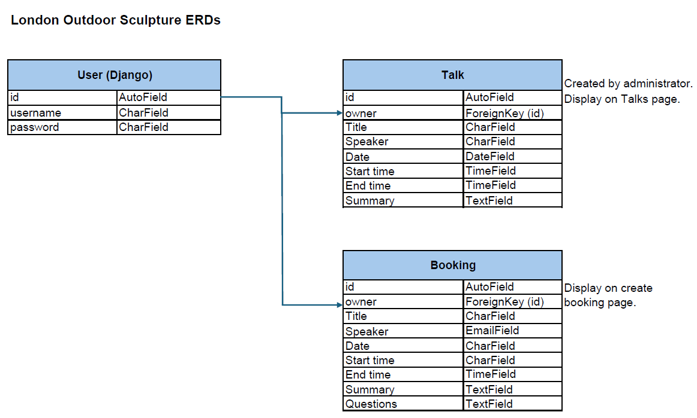
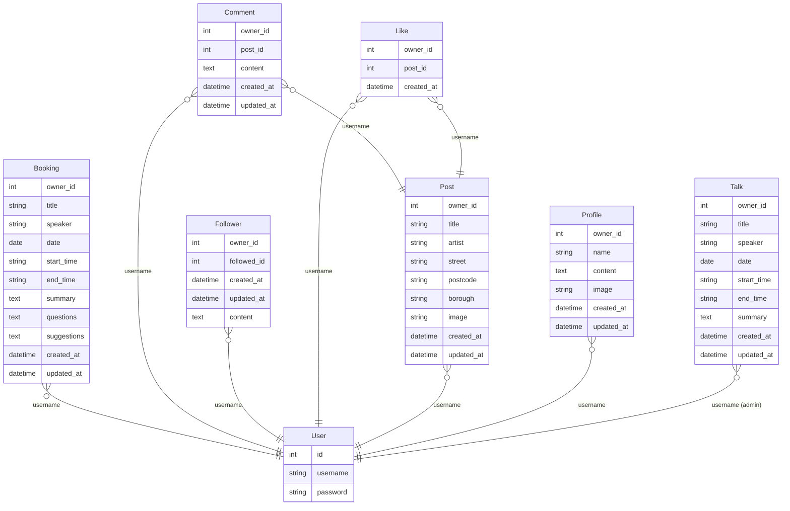
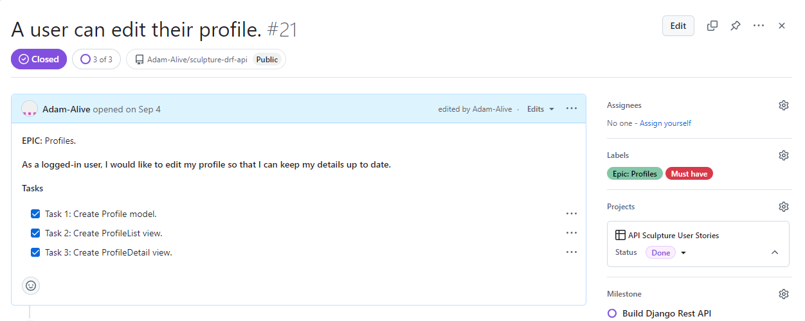

# [London Outdoor Sculpture API](https://sculpture-drf-api-2aa8ed66624d.herokuapp.com/)

## Project Purpose

The purpose of this project is to create a photo-sharing website for images of outdoor sculpture across the Greater London area.

Once registered, users will be able to post images, like and comment upon posts, follow other users and sign-up for online talks.

The site administrator will be able to monitor and modify all aspects of the site including the deletion of posts, comments and users if necessary.

## Project Structure

The project consists of a front-end, built using React, and a back-end API database built with the Django Rest Framework.

This section covers the back-end API, while the React front-end and project overall are covered here: **[London Outdoor Sculpture README](https://github.com/Adam-Alive/london-outdoor-sculpture/blob/main/README.md)**

The back-end API is deployed here: **[sculpture-drf-api](https://sculpture-drf-api-2aa8ed66624d.herokuapp.com/)**

The front-end website is deployed here **[London Outdoor Sculpture](https://london-outdoor-sculpture-392a8873bf1b.herokuapp.com/)**
## User Stories

User stories are listed here: **[User Stories](https://github.com/Adam-Alive/london-outdoor-sculpture/blob/main/README.md#user-stories)**

## Tools & Technologies Used

- [Markdown Builder](https://tim.2bn.dev/markdown-builder) to generate README and TESTING templates.
- [GitHub](https://github.com) for secure online code storage.
- [Gitpod](https://gitpod.io) as a cloud-based IDE for development.
- [Python](https://www.python.org) for back-end programming.
- [Django](https://www.djangoproject.com) as the Python framework for the site.
- [Dango Rest Framework](https://www.django-rest-framework.org) for building the back-end API.
- [PostgreSQL](https://www.postgresql.org) for relational database management.
- [Neon](https://neon.tech/) to host the PostgreSQL database.
- [Cloudinary](https://cloudinary.com) for online static file storage.
- [Heroku](https://www.heroku.com) for hosting the deployed back-end site.
- [Mermaid](https://mermaid.js.org/syntax/entityRelationshipDiagram.html) to generate ERDs for the completed project.

## Database Design

### Models
The database is comprised of eight models, including Django's User model:
- User (Django)
- Booking
- Comment
- Follower
- Like
- Post
- Profile
- Talk

I then constructed an ERD for each model and show here the Talk and Booking models:

At project completion I used [Mermaid](https://mermaid.js.org/syntax/entityRelationshipDiagram.html) to generate ERDs for the final project:

## Agile Project Management

For overall project management see: [London Outdoor Sculpture Agile Project Management](https://github.com/Adam-Alive/london-outdoor-sculpture/blob/main/README.md#agile-project-management)

### GitHub Projects and Issues

[GitHub Projects](https://github.com/Adam-Alive/sculpture-drf-api/projects?query=is%3Aopen) served as an Agile tool for developing the back-end API where epics and user stories were planned and then tracked on the [Kanban board](https://github.com/users/Adam-Alive/projects/12).

Using GitHub's projects and issues framework I created a GitHub project within the repository, and then developed issues within each:
- [API Sculpture User Stories](https://github.com/users/Adam-Alive/projects/12/views/1)

I created a user story template to manage user stories and provide here an example of a completed issue:

### MoSCoW Prioritisation

I used the MoSCow prioritisation model to add labels to my user stories within the issues tab:

- **Must Have**: guaranteed to be delivered.
- **Should Have**: adds significant value, but not vital.
- **Could Have**: has small impact if left out (and not included for the purposes of this project).
- **Won't Have**: not a priority for this iteration (and not included for the purposes of this project).

### Summary of closed issues:

- 

## Testing

For all testing, please refer to the [TESTING.md](TESTING.md) file.

## Deployment

### PostgreSQL Database

This project uses a PostgreSQL database at [Neon](https://neon.tech/).

### Cloudinary API

This project uses the [Cloudinary API](https://cloudinary.com) to store media assets online since Heroku doesn't persist this type of data.

### Heroku Deployment

This project uses [Heroku](https://www.heroku.com), a platform as a service (PaaS), that enables developers to build, run, and operate applications entirely in the cloud.

## Credits

### Content

| Source | Notes |
| --- | --- |
| [Code Institute](https://codeinstitute.net/) Advanced Front End Module| Django Rest Framework unit for guidance and inspiration in develping this API.|
| [Markdown Builder](https://tim.2bn.dev/markdown-builder) | An excellent tool to help generate Markdown files for the README. |
| [Stack Overflow](https://stackoverflow.com/) | For bugs and general troubleshooting. |
| [W3 Schools](https://www.w3schools.com/) | For general troubleshooting. |
